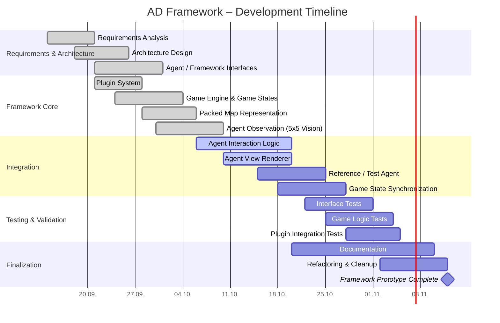

# Diary

# Development Log – AD Framework

**Developer:** Leonard Kämpf
**Project:** AD Framework
**Role:** Framework and Game Engine Development

This document records weekly development activities, technical decisions, problems, and upcoming tasks.

---

## Week 42 (12.10. – 16.10.2026)

### Activities
- Reviewed the existing framework architecture and agent interfaces.
- Prepared the project development plan and documentation.
- Planned integration testing using a simple reference agent.
- Reviewed the requirements for host-agent communication.
- Integration of given Agent Interface

### Decisions
- Adjusting current version to use the provided Agent Interface.

### Open Issues / Next Steps
- Verify game-state synchronization.
- Test the complete execution cycle with a reference agent.
- Test possibilities to transfer more fields between Host and Agent in the same amount of Bits

---

## Week 41 (05.10. – 09.10.2026)

### Activities
- Continued development of the observation system.
- Reviewed movement handling and agent interaction.
- Investigated the separation between game logic and rendering.

### Decisions
- Agents receive information only through the defined observation interface.
- Game logic and graphical rendering remain independent.

### Open Issues / Next Steps
- Validate the observation window near map boundaries.
- Complete the agent-specific visualization.
- Prepare interface tests.

---

## Week 40 (28.09. – 02.10.2026)

### Activities
- Implemented a compact map representation using four bits per cell.
- Implemented bitwise encoding and decoding of map cells.
- Introduced a 5x5 observation area for agents.
- Integrated graphical visualization using SFML.
- Fixed compilation and linker errors.

### Decisions
- Store two map cells per byte using `uint8_t`.
- Use a fixed observation radius of two cells.

### Problems
- Incorrect number of visible cells in the initial observation view.
- Multiple-definition linker error in movement helper functions.

### Next Steps
- Validate observation extraction.
- Continue agent interface integration.

---

## Week 39 (21.09. – 25.09.2026)

### Activities
- Established the modular C++ project structure.
- Implemented initial DLL plugin loading.
- Introduced PluginManager and GameEngine components.
- Created a build script using MSYS2.
- Resolved compilation and initialization errors.

### Decisions
- Separate game engine, plugin system, and renderer.
- Use DLL-based plugins for agent integration.

### Problems
- Incorrect header include paths.
- GameEngine constructor failed due to missing Map initialization.

### Next Steps
- Integrate map and agent interfaces.
- Implement observation handling.

---

## Week 38 (14.09. – 18.09.2026)

### Activities
- Analyzed functional and non-functional requirements.
- Developed the initial software architecture.
- Investigated communication between framework and agents.
- Defined preliminary module responsibilities.

### Decisions
- Implement the framework in C++.
- Keep agent implementations independent of the host.
- Separate game logic from visualization.

### Next Steps
- Establish the project structure.
- Implement dynamic plugin loading.

## Project Timeline

The following Gantt chart shows the development progress and planned milestones of the AD Framework.

